[**한국어**](README.ko.md)

<p align="center">
  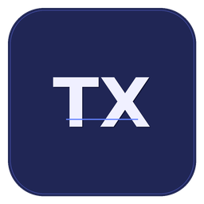
</p>

<h1 align="center">TextEx</h1>

<p align="center">
  A free, local-first LaTeX editor with a live PDF preview.<br />
  No TeX installation, no account, no cloud.
</p>

<p align="center">
  <a href="https://github.com/Topasm/textex/actions/workflows/build.yml"></a>
  <a href="https://github.com/Topasm/textex/releases/latest"></a>
  <a href="https://github.com/Topasm/textex/releases"></a>
  <a href="LICENSE"></a>
  
</p>

<p align="center">
  <a href="https://github.com/Topasm/textex/releases/latest"><b>Download for Windows</b> (.exe)</a> ·
  <a href="https://github.com/Topasm/textex/releases/latest"><b>macOS</b> (Apple Silicon .dmg)</a> ·
  <a href="https://github.com/Topasm/textex/releases/latest"><b>Linux</b> (.AppImage / .deb)</a>
</p>

<p align="center">
  <picture>
    <source media="(prefers-color-scheme: dark)" srcset="docs/images/hero-dark.png" />
    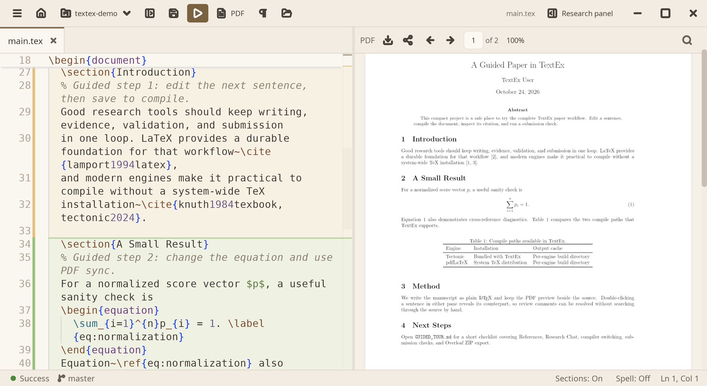
  </picture>
</p>

<p align="center">
  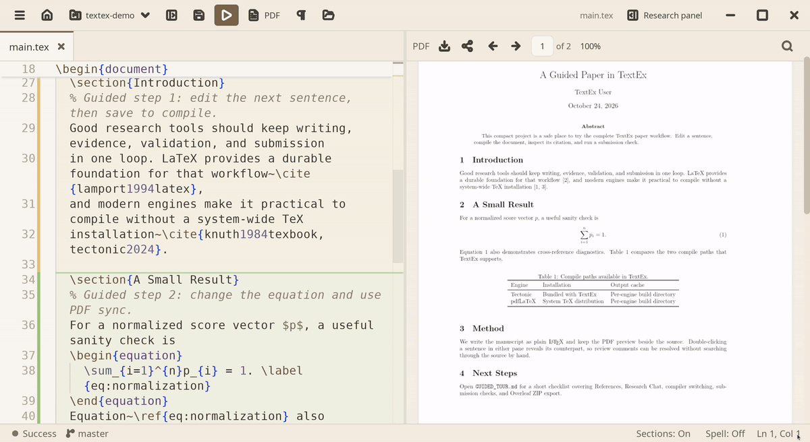
  <br />
  <sub>Edit → save → the PDF recompiles → Ctrl+click the PDF to jump back to the source line.</sub>
</p>

## Why TextEx

- **Zero setup.** A [Tectonic](https://tectonic-typesetting.github.io/) engine is bundled, so you never install TeX Live or MiKTeX. A system pdfLaTeX can be selected in Settings if you prefer it.
- **Local-first.** Your documents stay on your machine. There is no account and no cloud service; only the optional AI providers and online reference search touch the network.
- **Work from the PDF.** Ctrl/⌘+click any line in the preview to jump to its source, double-click a sentence to edit it in place, and keep both panes aligned with scroll sync.
- **Built for papers.** A References sidebar with Zotero and Crossref/arXiv search, BibTeX autocomplete, a submission check, Git, local history, and an Overleaf-ready ZIP export.

## Features

<table>
  <tr>
    <td width="50%" valign="top">
      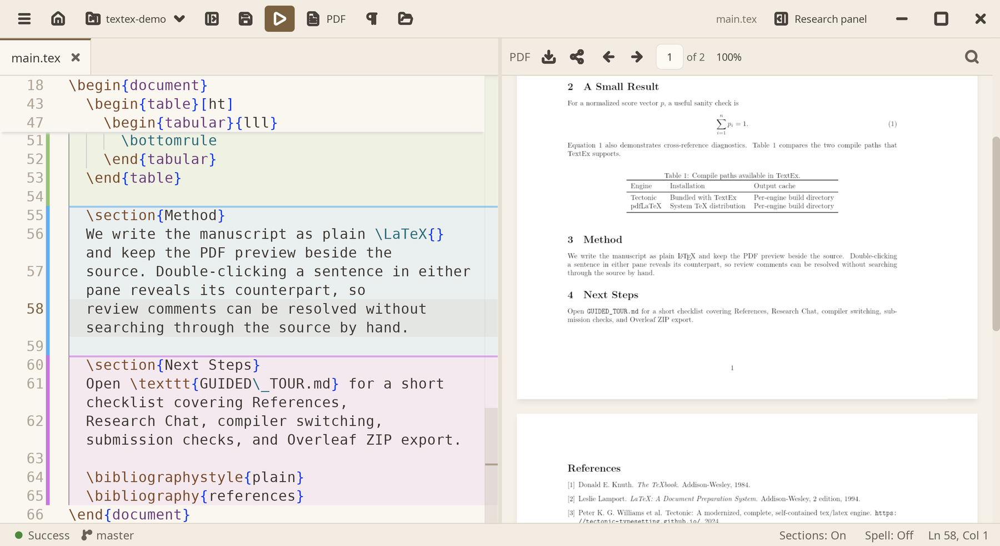
      <p><b>Live preview &amp; SyncTeX.</b> Save to recompile. Ctrl/⌘+click the PDF to jump to the source line; scroll sync keeps both panes together.</p>
    </td>
    <td width="50%" valign="top">
      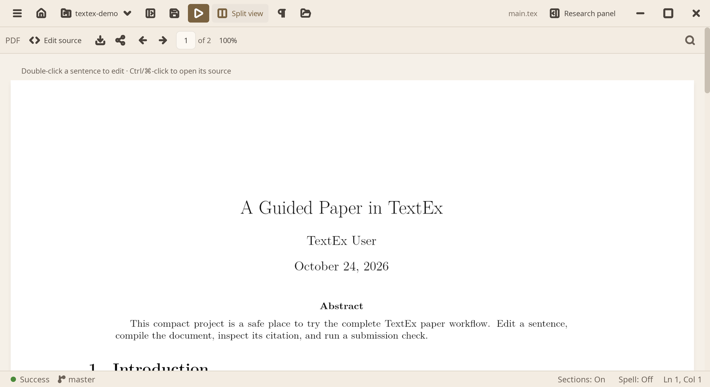
      <p><b>Edit from the PDF.</b> A focused PDF workspace: double-click a sentence to edit it manually or polish it with AI, then apply and refresh.</p>
    </td>
  </tr>
  <tr>
    <td width="50%" valign="top">
      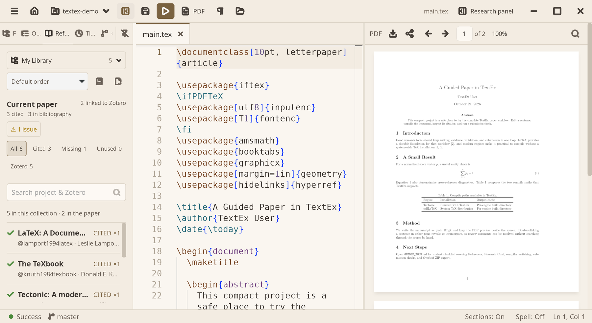
      <p><b>References &amp; Zotero.</b> See what is cited, missing, or unused; search your Zotero library or Crossref/arXiv; drag a paper into the editor to cite it.</p>
    </td>
    <td width="50%" valign="top">
      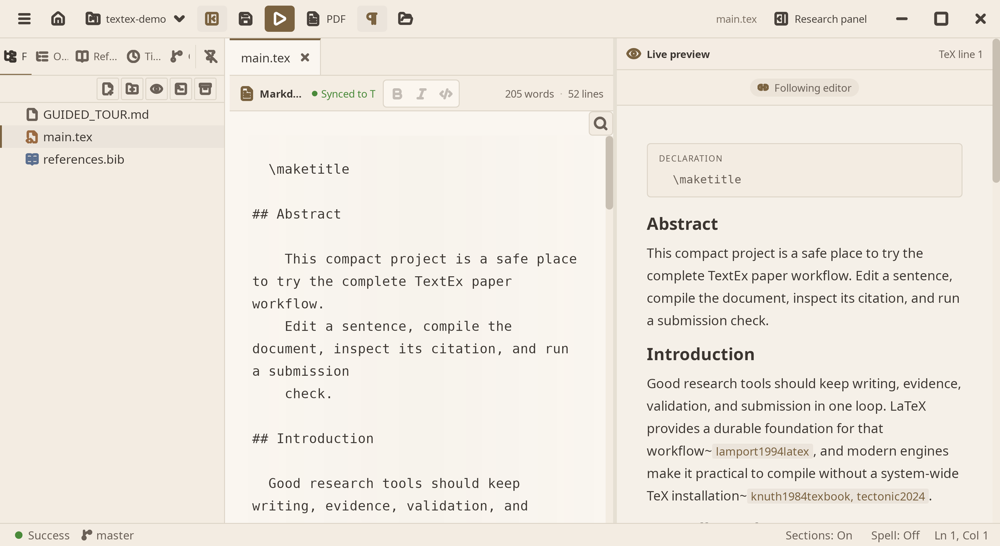
      <p><b>Prose view.</b> Draft in a focused Markdown projection next to a live rendering while <code>.tex</code> stays the canonical file.</p>
    </td>
  </tr>
  <tr>
    <td width="50%" valign="top">
      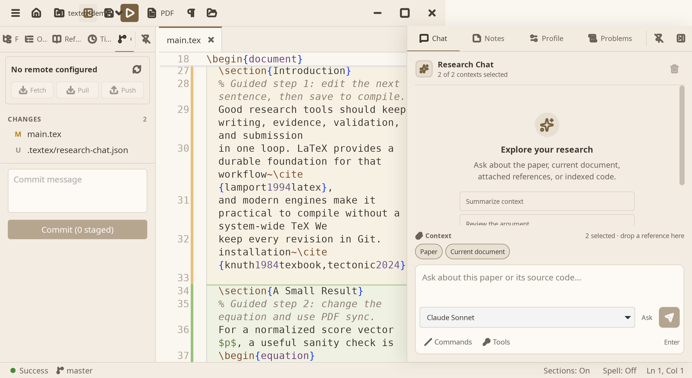
      <p><b>Git &amp; Timeline.</b> Stage, commit, fetch, pull, and push from the sidebar, and roll back to any earlier local save from the Timeline.</p>
    </td>
    <td width="50%" valign="top">
      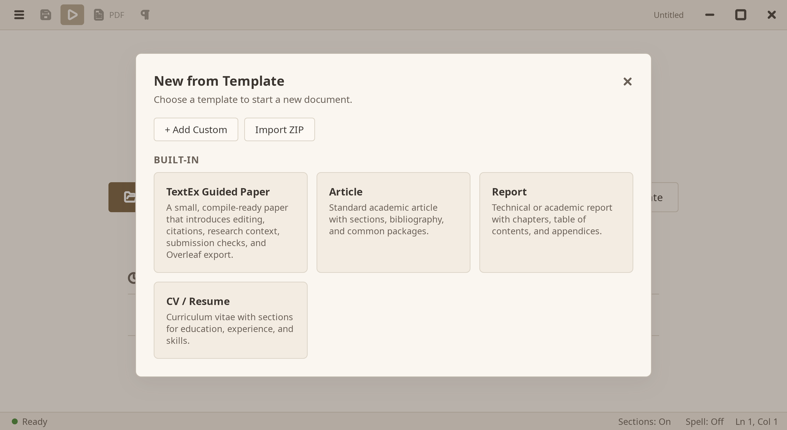
      <p><b>Templates &amp; export.</b> Start from an article, report, or CV template, then export a clean Overleaf ZIP or DOCX/ODT/HTML/EPUB via Pandoc.</p>
    </td>
  </tr>
</table>

<details>
<summary><b>More: research chat, outline, and the in-app guide</b></summary>

<p align="center">
  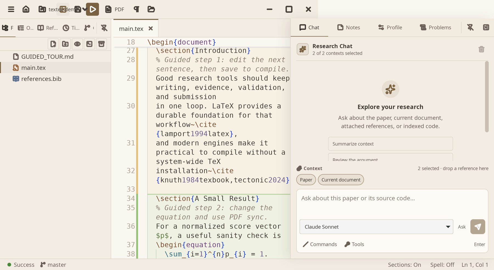
  <br /><sub><b>Research chat.</b> Ask about the paper, the current document, or attached references through an API provider, Claude Code, or Codex CLI. Off until you enable it.</sub>
</p>

<p align="center">
  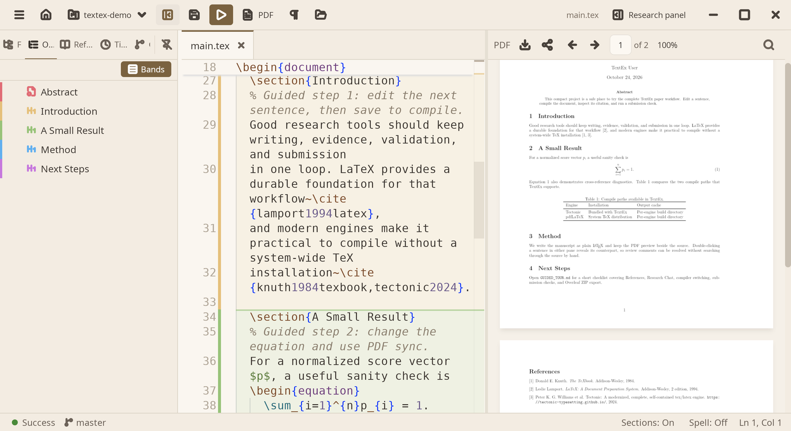
  <br /><sub><b>Outline.</b> Section bands in the gutter and a clickable document outline.</sub>
</p>

Press <kbd>F1</kbd> inside the app for the searchable guide, including trackpad gestures and a three-minute checklist.

</details>

> **Optional integrations.** AI providers and online reference search need network access. Claude Code and Codex CLI features need the matching executable on `PATH`. The editor and the bundled compiler work without any of them.

## Quick start

1. **Download** the latest build from the [Releases page](https://github.com/Topasm/textex/releases/latest): a Windows `.exe` installer, a macOS Apple Silicon `.dmg`, or a Linux `.AppImage` / `.deb`.
2. **Open a folder** or pick **New from Template** on the home screen. The guided demo paper walks through citations, research chat, the submission check, and Overleaf export.
3. **Save** with <kbd>Ctrl/⌘ + S</kbd>. The document compiles and the preview updates. The first compile may download TeX support files; later compiles work offline.

**macOS:** the app may be quarantined. Either right-click the app and choose **Open**, or run:

```bash
xattr -cr /Applications/TextEx.app
```

**Linux:** make the AppImage executable:

```bash
chmod +x TextEx_*.AppImage
./TextEx_*.AppImage
```

## Keyboard shortcuts

| Shortcut | Action |
|----------|--------|
| `Ctrl/Cmd + S` | Save (and compile) |
| `Ctrl/Cmd + Enter` | Compile |
| `Ctrl/Cmd + P` | Open a project file |
| `Ctrl/Cmd + Shift + P` | Command palette |
| `Ctrl/Cmd + B` | Toggle sidebar |
| `Ctrl/Cmd + L` | Toggle log panel |
| `Ctrl/Cmd + F` | Find in current document |
| `Ctrl/Cmd + Shift + C` | Search citations |
| `Ctrl/Cmd + Shift + F` | Search PDF text |
| `Shift + Alt + F` | Format document |
| `Ctrl/Cmd + 0` / `9` | Fit PDF to width / height |
| `F1` | In-app guide |

## Learn more

- [User Guide](docs/USER_GUIDE.md) — projects, editing, compiling, SyncTeX, citations, and productivity tools
- [Settings Reference](docs/SETTINGS.md) · [Zotero Integration](docs/ZOTERO.md) · [Research Profile & Chat](docs/RESEARCH_PROFILE.md)
- [CLI Reference](docs/CLI.md) · [MCP Server](docs/MCP.md)
- [Development Guide](docs/DEVELOPMENT.md) · [Architecture](docs/ARCHITECTURE.md) · [Packaging](docs/PACKAGING.md)

TextEx speaks English, Korean, Spanish, French, German, Portuguese, and Chinese.

## Open-Source Notices

Bundled notice artifacts live in `resources/licenses/`, including npm and Rust
dependency notices plus the Tectonic license files.
[docs/LICENSES.md](docs/LICENSES.md) is a human-readable summary, not the full
bundled notice set.

## License

[MIT](LICENSE)
